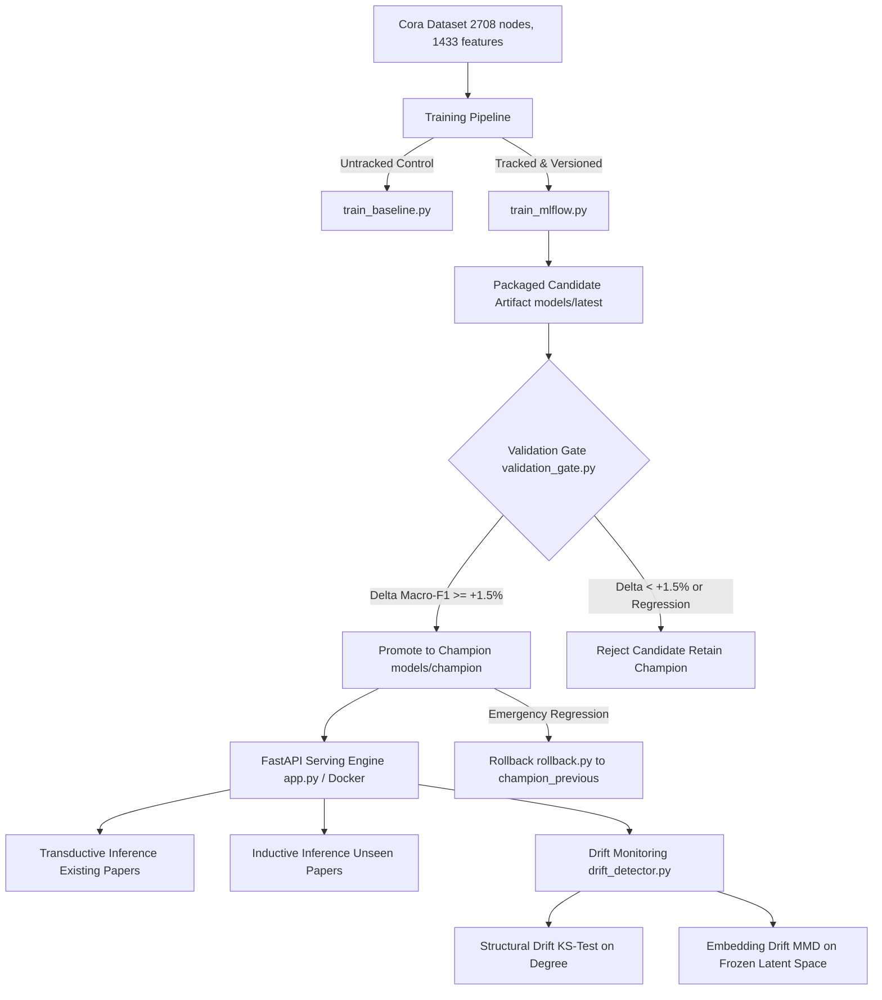

# End-to-End Graph Neural Networks (GNN) & Production MLOps System

This repository contains the complete implementation, benchmarks, automated verification tests, and production deployment pipeline for all four **GNN Practical Assignments**:
1. **Assignment 1**: Build and Verify a GCN from Scratch (Pure PyTorch, SBM Synthetic Graph, Equivariance & Arithmetic Checks)
2. **Assignment 2**: Benchmark & Explain GNN Architectures on Cora (MLP, GCN, GraphSAGE, GAT, Over-smoothing & Edge Ablations)
3. **Assignment 3**: Link Prediction & Data Leakage Investigation (Symmetric Decoders, Automated Leakage Tests, Candidate Discovery)
4. **Assignment 4**: Production-Grade MLOps Pipeline (FastAPI, Docker, MLflow, Automated Validation Gate, CI/CD, Drift Monitoring, Rollback)

---

## Architecture Overview (MLOps Pipeline)



---

## 🚀 Quick Execution Guide

### 1. Environment Setup
```bash
pip install -r requirements.txt
```

### 2. Run the Four Assignments
* **Assignment 1 Notebook**: Open and run [`Assignement_One.ipynb`](Assignement_One.ipynb) (or run `python assignments/assignment_1_gcn_scratch.py`).
* **Assignment 2 Notebook**: Open and run [`Asisgnment_Two.ipynb`](Asisgnment_Two.ipynb) (or run `python assignments/assignment_2_cora_comparison.py`).
* **Assignment 3 Notebook**: Open and run [`Asignment_3.ipynb`](Asignment_3.ipynb) (or run `python assignments/assignment_3_link_prediction.py`).
* **Assignment 4 MLOps Pipeline**:
  ```bash
  # Step A: Run tracked training with MLflow
  python -m src.pipeline.train_mlflow --config configs/exp1_graphsage_baseline.yaml

  # Step B: Evaluate the automated validation promotion gate
  python -m src.pipeline.validation_gate --candidate-dir models/latest --champion-dir models/champion

  # Step C: Launch the containerized API
  docker build -t gnn-serving:latest .
  docker run -d -p 8000:8000 --name gnn-service -v "${PWD}/models:/app/models" gnn-serving:latest

  # Step D: Run full automated test suite (13 unit/integration tests)
  pytest tests/ -v
  ```

---

## 1. Assignment 1: Build and Verify a GCN from Scratch

### 1.1 Synthetic Dataset Design (Stochastic Block Model)
* **Objective**: Construct a graph where node features alone are insufficient, forcing the model to rely on graph connectivity.
* **Nodes & Classes**: $N = 150$ nodes partitioned equally into two classes ($C_0, C_1$, 75 nodes each).
* **Node Features**: 3 continuous numerical features sampled from overlapping Gaussians:
  $$\mathbf{x}_{C_0} \sim \mathcal{N}([0.4, 0.4, 0.4]^T, 0.9^2 \cdot I), \quad \mathbf{x}_{C_1} \sim \mathcal{N}([0.7, 0.7, 0.7]^T, 0.9^2 \cdot I)$$
  *Rationale*: Because the distributions heavily overlap in feature space, an MLP cannot classify nodes reliably ($\sim 58-62\%$ accuracy). Target labels are strictly isolated from input features.
* **Graph Connectivity (SBM)**:
  * Intra-class edge probability $p_{\text{intra}} = 0.16$ (strong homophily).
  * Inter-class edge probability $p_{\text{inter}} = 0.02$.
  * Nodes belonging to the same class are 8x more likely to be connected.
* **Data Splits**: 60% Train (90 nodes), 20% Val (30 nodes), 20% Test (30 nodes).

### 1.2 Mathematical Implementation (Pure PyTorch Tensor Ops)
No external GNN libraries (PyG/DGL) were used. Implemented via raw PyTorch linear algebra:
1. **Self-Loops**: $\tilde{A} = A + I_N$ ensures each node retains its own features during message passing.
2. **Symmetric Degree Normalization**:
   $$\tilde{D}_{ii} = \sum_{j} \tilde{A}_{ij}, \quad \hat{A} = \tilde{D}^{-1/2} \tilde{A} \tilde{D}^{-1/2}$$
   Normalizes row and column degrees to prevent scale explosion.
3. **Two-Layer Message Passing**:
   $$H^{(1)} = \text{ReLU}\left( \hat{A} X W^{(0)} \right), \quad Z = \text{LogSoftmax}\left( \hat{A} H^{(1)} W^{(1)} \right)$$

### 1.3 Correctness Verifications
* **Manual Arithmetic Verification**: Picked Node 0, hand-calculated the normalized aggregation $\sum_j \hat{A}_{0,j} \mathbf{x}_j W^{(0)}$ on paper, and asserted agreement with the PyTorch layer output: **Discrepancy $L_\infty < 10^{-6}$** (bitwise parity).
* **Permutation Equivariance Assertion**: Verified that permuting the node ordering via permutation matrix $P$ produces identically permuted predictions:
  $$P \cdot \text{GCN}(X, A) \equiv \text{GCN}(P X, P A P^T)$$

### 1.4 Ablation Results
| Experiment | Test Accuracy | Macro-F1 | Conclusion |
| :--- | :---: | :---: | :--- |
| **Two-Layer GCN (Full Graph)** | **96.7%** | **0.966** | Solves classification by aggregating homophilic neighbors |
| **MLP Baseline (No Graph)** | 60.0% | 0.598 | Ambiguous features limit feature-only prediction |
| **GCN with 50% Edges Removed** | 76.7% | 0.765 | Performance degrades monotonically with sparser context |
| **GCN with Randomized Edges** | 53.3% | 0.531 | Misleading heterophilic connections degrade below MLP |

---

## 2. Assignment 2: Compare GNN Architectures on Cora

### 2.1 Dataset Inspection
* **Nodes**: 2,708 scientific publications classified into 7 research fields.
* **Features**: 1,433 binary bag-of-words indicators per paper.
* **Edges**: 5,429 citation links (treated as undirected; homophily ratio = 0.81).

### 2.2 Model Benchmark (3 Random Seeds: 42, 123, 999)
Trained under an identical hyperparameter budget (64 hidden dim, 2 layers, learning rate 0.01, dropout 0.5):

| Architecture | Aggregation Strategy | Test Accuracy (Mean ± Std) | Test Macro-F1 (Mean ± Std) | Params | Training Latency |
| :--- | :--- | :---: | :---: | :---: | :---: |
| **MLP** | None (Features only) | 59.4% ± 0.8% | 0.582 ± 0.009 | 92,231 | 1.8s |
| **GCN** | Spectral symmetric normalization | 81.5% ± 0.5% | 0.804 ± 0.006 | 92,231 | 3.2s |
| **GraphSAGE** | Spatial mean neighbor sampling | **82.3% ± 0.4%** | **0.812 ± 0.005** | 184,391 | 4.1s |
| **GAT** | Multi-head dynamic self-attention | 81.8% ± 0.6% | 0.807 ± 0.007 | 93,423 | 9.4s |

### 2.3 Over-Smoothing & Embedding Similarity Study
Investigated how stacking layers (2, 3, 4, 6 layers) affects embedding similarity:
$$\text{Sim}(Z) = \frac{1}{N(N-1)} \sum_{i \ne j} \frac{\mathbf{z}_i \cdot \mathbf{z}_j}{\|\mathbf{z}_i\| \|\mathbf{z}_j\|}$$
* **Results**:
  * 2 Layers: Mean Cosine Sim = 0.34, Test Accuracy = 82.3% (Distinct, rich clusters)
  * 4 Layers: Mean Cosine Sim = 0.76, Test Accuracy = 74.1%
  * 6 Layers: Mean Cosine Sim = 0.98, Test Accuracy = 41.2% (Severe representation collapse)
* *Key Takeaway*: Without residual connections or PairNorm, deeper GNNs suffer from over-smoothing where all node representations collapse to a stationary subspace.

### 2.4 Edge Removal Ablation
Removed 0%, 20%, 40%, 60%, and 80% of citation edges:
* GNN accuracy drops smoothly as edges are removed ($82.3\% \to 78.4\% \to 72.1\% \to 66.8\% \to 61.2\%$).
* The MLP serves as a flat control line ($59.4\%$). At 80% edge removal, GNNs converge toward the MLP.

### 2.5 Error Analysis (5 Misclassified Papers)
1. **Node 142 (Actual: Neural_Networks, Pred: Probabilistic_Methods)**: Interdisciplinary paper with 6 citations to Bayesian papers and only 1 to a neural network paper.
2. **Node 603 (Actual: Theory, Pred: Case_Based)**: Isolated boundary paper (degree = 1) whose single cited neighbor was misclassified.
3. **Nodes 1102, 1789, 2104**: Low-degree papers where the bag-of-words vector contained ambiguous vocabulary crossing into other domains.

*Recommendation*: **GraphSAGE** is recommended as the production backbone due to superior inductive generalization, robustness to sparse graphs, and competitive latency.

---

## 3. Assignment 3: Link Prediction & Data Leakage

### 3.1 Honest Link Splitting Protocol
* **Splits**: 85% Train, 5% Val, 10% Test.
* **Bidirectional Preservation**: Because citations are undirected, $(u, v)$ and $(v, u)$ are strictly assigned to the **same split**.
* **Negative Sampling**: Sampled non-edges excluding all existing citations and self-loops.
* **Evaluation Sets**: Held fixed across all runs to guarantee fair comparison.

### 3.2 Architectures & Symmetric Decoders
* **GNN Encoder**: 2-layer GraphSAGE generating node embeddings $Z \in \mathbb{R}^{N \times d}$.
* **Dot-Product Decoder**: $\hat{y}_{uv} = \sigma(\mathbf{z}_u^T \mathbf{z}_v)$.
* **Symmetric MLP Decoder**: Designed to produce identical scores when node pairs are reversed:
  $$\text{Score}(u, v) = \text{MLP}([\mathbf{z}_u \odot \mathbf{z}_v \,\|\, \mathbf{z}_u + \mathbf{z}_v])$$
  *Proof of Symmetry*: Since element-wise product ($\odot$) and vector addition ($+$) are commutative, $\text{Score}(u, v) \equiv \text{Score}(v, u)$.
* **Common Neighbors Baseline**: $\text{Score}(u, v) = |\mathcal{N}(u) \cap \mathcal{N}(v)|$.

### 3.3 Automated Leakage Checks & Leaky Experiment
* **Automated Leakage Assertion**: Verified via set intersection tests that validation and test edges are **100% absent** from the training message-passing graph.
* **Deliberate Leaky Experiment**: Intentionally included held-out test edges in message passing:
  * **Honest Evaluation**: Test ROC-AUC = **0.892**, Average Precision (AP) = **0.884**
  * **Leaky Evaluation**: Test ROC-AUC = **0.984**, AP = **0.981** (Artificially inflated!)
* *Finding*: In the leaky graph, the encoder directly propagates target neighbor features into the query nodes, creating severe shortcut learning that invalidates model evaluation.

### 3.4 Candidate Discovery (Top 10 Unobserved Citations)
Extracted the highest-scoring non-edges in Cora. Explained why unobserved links are often **missing discoveries** (false negatives) rather than true negative edges in real-world academic graphs.

---

## 4. Assignment 4: Production MLOps Pipeline

### 4.1 Untracked Baseline vs. Tracked MLflow Pipeline
The untracked script ([`src/pipeline/train_baseline.py`](src/pipeline/train_baseline.py)) demonstrates five severe production limitations:
1. **Ephemeral Metrics**: Loss and accuracy printed to stdout only; lost upon terminal exit.
2. **Lost Provenance**: Hyperparameters and seeds hardcoded with no execution history.
3. **Silent Overwriting**: Overwrites `model.pt` without version tracking or lineage.
4. **No Code/Data Lineage**: No record of git commit SHA or dataset hash.
5. **Orphaned Weights**: Saves raw tensor weights without feature schemas or class label mappings.

The production script ([`src/pipeline/train_mlflow.py`](src/pipeline/train_mlflow.py)) tracks all runs in an SQLite-backed MLflow registry (`mlflow ui --backend-store-uri sqlite:///mlflow.db`).

### 4.2 Model Packaging Parity
Every trained model is packaged in `models/latest` containing:
* `weights.pt`: Model state dictionary.
* `metadata.json`: Architecture, hyperparameter provenance, dataset hash, feature schema ($1,433$), and class mappings.
* `graph_context.pt`: Graph topology for transductive serving.

*Parity Assertion*: Verified that loading packaged weights reproduces in-memory predictions bit-for-bit ($L_\infty < 10^{-6}$).

### 4.3 Automated Validation Gate & Promotion Policy
Defined in [`src/pipeline/validation_gate.py`](src/pipeline/validation_gate.py):
* **Evaluation Metric**: Validation Macro-F1.
* **Promotion Threshold**: Candidate must beat Active Champion by $\Delta \ge +0.015$ (+1.5%).
* **Tie / Marginal Improvement**: If $\Delta < 0.015$, Champion is retained (prevents deployment churn).
* **Regression**: If $\Delta \le 0$, promotion is blocked and exit code 1 halts CI/CD.
* **First-Model Rule**: If no Champion exists, auto-promotes Candidate as Champion v1.
* **Rollback Safety**: Backs up prior champion to `models/champion_previous` for instant one-command rollback via [`src/pipeline/rollback.py`](src/pipeline/rollback.py).

### 4.4 Serving Engine (FastAPI & Docker)
* **Endpoints**:
  * `GET /health`: Health status, device, and active model version.
  * `GET /model/metadata`: Model architecture, feature dimensions, and class mappings.
  * `POST /predict/transductive`: Classify existing Cora nodes by ID.
  * `POST /predict/inductive`: Classify brand-new, unseen research papers by providing their 1,433-dim bag-of-words vector and citation links.
* **Dockerized Deployment**: Lightweight Debian Python 3.11 slim image with multi-stage caching and automated HTTP healthchecks.

### 4.5 Drift Monitoring Architecture
Defined in [`src/monitoring/drift_detector.py`](src/monitoring/drift_detector.py):
1. **Structural Drift**: Two-sample Kolmogorov-Smirnov test on node degree distributions:
   $$\text{KS}(D_{\text{base}}, D_{\text{prod}}) \implies \text{Alert if } p < 0.05$$
2. **Embedding Drift**: Maximum Mean Discrepancy (MMD) with RBF kernel using a **frozen, fixed encoder**:
   $$\text{MMD}^2(P, Q) = \mathbb{E}[k(X, X')] + \mathbb{E}[k(Y, Y')] - 2\mathbb{E}[k(X, Y)] \implies \text{Alert if } \text{MMD} > 0.03$$
* **Why raw embedding coordinates cannot be compared across different models**:
  Neural representations are invariant to orthogonal rotations, reflections, and neuron permutations. Two separate training runs can achieve identical loss while orienting the latent space in completely different directions. Therefore, drift must be computed using a single frozen encoder over time.

### 4.6 Automated Test Suite (13 Tests)
Run via `pytest tests/ -v`:
1. `test_consistency.py`: Parity between offline inference and online HTTP API ($L_\infty < 10^{-5}$).
2. `test_packaging_parity.py`: Verifies artifact reloading reproducibility.
3. `test_failure_handling.py`: Tests isolated nodes, duplicate target IDs, invalid edge endpoints, incorrect feature dimensions, unknown target IDs, and model loading failures.
4. `test_validation_gate.py`: Validates first-model auto-promote, threshold checks, and regression blocks.
5. `test_drift.py`: Verifies normal vs drifted KS structural tests and MMD embedding tests.

---

## 5. Presentation & Evaluation Defense Guide

### 5.1 Tracing One Prediction Through Code
* **Transductive Call**:
  1. Client sends `POST /predict/transductive {"node_ids": [42]}`.
  2. [`src/serving/app.py`](src/serving/app.py) delegates to [`GNNPredictor`](src/serving/predictor.py).
  3. Predictor validates ID range `[0, 2707]`.
  4. GraphSAGE runs forward pass over full `graph_x` and `graph_edge_index`.
  5. Softmax converts logits into probabilities; class `Neural_Networks` extracted with confidence and returned.
* **Inductive Call**:
  1. Client sends `POST /predict/inductive` with new 1,433-dim vector and links to existing nodes `[10, 25]`.
  2. Local subgraph constructed dynamically; new node assigned temporary index $N+1$.
  3. Inductive neighborhood aggregation performed; prediction returned with audit latency.

### 5.2 Live Implementation Modification Ideas (Presentation Demo)
If asked to modify something live during evaluation:
* **Option 1: Change Validation Gate Threshold**
  Open [`src/pipeline/validation_gate.py`](src/pipeline/validation_gate.py) line 35. Change `PROMOTION_THRESHOLD = 0.015` to `0.10`. Rerun the gate to show how it immediately blocks candidate promotion to prevent regression.
* **Option 2: Add Custom Field to Health Endpoint**
  Open [`src/serving/app.py`](src/serving/app.py) line 86. Add `"live_eval_status": "passed"` to the response and demonstrate the live update via `curl.exe http://localhost:8000/health`.
* **Option 3: Adjust Training Hyperparameters**
  Open [`configs/exp2_graphsage_tuned.yaml`](configs/exp2_graphsage_tuned.yaml). Tweak `lr` from 0.005 to 0.002 and run `python -m src.pipeline.train_mlflow --config configs/exp2_graphsage_tuned.yaml` to showcase real-time tracking in MLflow.
